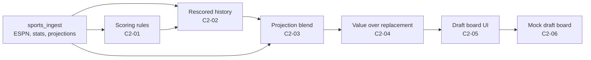

# Architecture

> **Status:** plan only; no app code exists. When code lands and differs, update this file in the
> same PR.

- **Input** comes only from `sports_ingest`, live or from a snapshot. This repo doesn't fetch,
  cache or match players itself.
- **Scoring rules** come from ESPN league settings or a JSON file shaped like the ScoringSystem tab.
- **Values** depend on league size and roster slots. Whether hockey also needs categories valuation
  is open (C2-07).
- **Output** that includes licensed data stays outside the repo
  ([ADR 0001](adr/0001-scaffold-and-licensed-data-guard.md)).

Not decided yet: the UI technology (C2-05) and how the app depends on the gem (C2-01).
